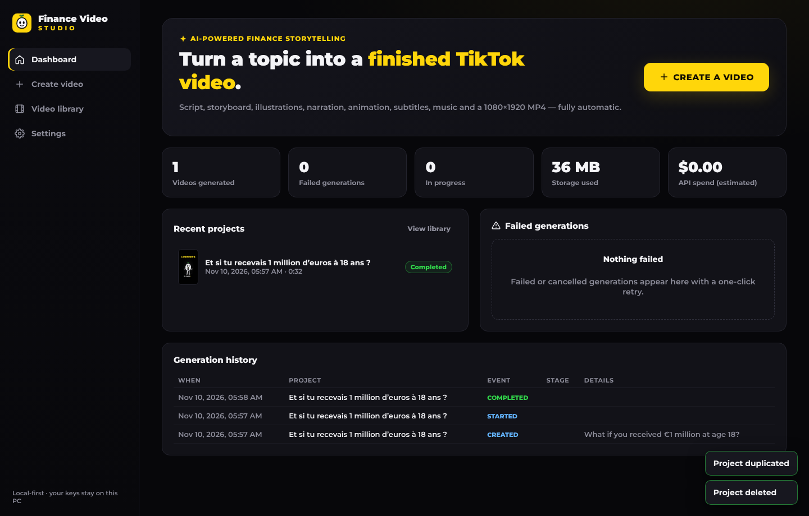

# Finance Video Studio

A Windows desktop app that turns a one-line topic into a finished, animated, narrated **1080×1920 TikTok video** in the minimalist finance-storytelling style. You get a black background, an original white mascot, flat financial illustrations, white captions with yellow and red highlights, music and sound effects.

Type a topic → click **GENERATE VIDEO** → get a validated MP4. You never edit scenes by hand.

```
"What if you received €1 million at age 18?"
  → script → storyboard → illustrations → voice → animation → subtitles → render → MP4
```

The default setup runs **fully offline at zero API cost**: a built-in story engine, local neural voices (Piper), a vector illustration library and procedurally generated music. Cloud providers (Anthropic Claude, OpenAI, ElevenLabs) are optional and interchangeable.



**Reference test video:** [`samples/test-video-1-million-18-ans.mp4`](samples/test-video-1-million-18-ans.mp4). It was generated fully automatically from *"What if you received €1 million at age 18?"*: French, 60.5 s, original mascot, Piper narration, animated subtitles, music and SFX. [Contact sheet](samples/test-video-contact-sheet.png).

---

## Contents

- [Quick start](#quick-start)
- [What the app does](#what-the-app-does)
- [Architecture](#architecture)
- [Providers](#providers)
- [Generation pipeline](#generation-pipeline)
- [Project storage](#project-storage)
- [Testing](#testing)
- [Packaging the Windows installer](#packaging-the-windows-installer)
- [Licensing notes](#licensing-notes)
- [Known limitations](#known-limitations)

---

## Quick start

Requirements: **Node.js 20+** (22 recommended) and Windows 10/11 x64. Linux and macOS also work for development.

```bash
npm install
npm run build          # typecheck + renderer + main process + pre-bundled Remotion animations
npm start              # launch the desktop app
```

The first video downloads a Piper voice (about 20–64 MB, from the official Piper GitHub release) and Remotion's headless Chrome. This happens once; later videos run offline.

Development mode with hot-reloading UI:

```bash
npm run dev
```

Headless generation from the command line uses the same pipeline:

```bash
npm run build:main
node dist/cli/generate.cjs --topic "What if you received €1 million at age 18?" --lang fr --duration 60 --out video.mp4
```

Preview and tweak the animation library in Remotion Studio:

```bash
npm run studio
```

---

## What the app does

| Screen | Features |
|---|---|
| **Dashboard** | Logo, *Create a video*, recent projects, completed videos, failed generations with one-click retry, generation history, total videos, storage used, estimated API spend |
| **Video generator** | Topic, duration (30/45/60/90 s/auto), language (FR/EN/ES/DE), narrator (male/female/auto), storytelling mode, visual style (Finance-Lite-inspired / custom brand), fully automatic mode. A live pre-flight check tells you *before* generating if a provider can't handle the request. |
| **Generation progress** | The 8 real pipeline stages, current stage, %, current scene, ETA (measured from real render throughput), warnings, errors, **Retry** (resumes from the failed stage), **Cancel** |
| **Video library** | Thumbnail, title, date, duration, file size, status. Play, open file location, regenerate (everything / voice / sound / re-render only), duplicate, delete |
| **Settings** | LLM, image and TTS providers and models; API keys (encrypted with Windows DPAPI via Electron `safeStorage`, never sent to the UI or logs); voice selection and download; default duration and language; export quality; output folder; brand colours; music, SFX and narration volume; render concurrency; FFmpeg and Chrome paths; cache size and clearing; pricing for cost estimates; system information |

### Visual system

- **Nummo**, an original mascot: a white egg-shaped character with simple black eyes and a small green sprout (money that grows). It is drawn in SVG from joint angles, so it looks exactly the same in every scene. It has **14 poses** (idle, walking, running, sitting, thinking, surprised, happy, sad, shocked, pointing, holding money, holding phone, explaining, celebrating) and **10 expressions**, with blinking, breathing, a walk cycle and a mouth that animates while the narrator speaks.
- **36 vector illustrations** (hand-drawn plus Microsoft Fluent Emoji artwork, MIT): banknotes, coins, banks, houses, cars, phones, cards, laptops, charts, clocks, buildings, shops, piggy bank, calendar and more. All share one line style.
- **Animation library** (`src/remotion/anim.ts`) with one set of easing curves: pop, fade, float, fall, slide, rise, grow, shake, spin, pulse; camera zoom, pan, push-in, tilt and shake; character enter, exit, walk-across, jump, bounce, shiver and lean-in; scene transitions; money rain, coin burst, sparkles, impact, confetti, smoke and speed lines; animated line and bar charts; number counters.
- **Captions**: karaoke-style, 1–3 words per cue, white with automatic yellow emphasis (numbers, key words) and red for losses and risks. They sit in the TikTok-safe band, below the mascot's feet and clear of the platform UI and right-side buttons.

---

## Architecture

```
electron/            Main process: window, secure IPC (zod-validated), fvs-media:// protocol (HTTP ranges), safeStorage cipher
src/renderer/        React UI (Vite): Dashboard, Generator, Progress, Library, Settings
src/shared/          Constants, zod schemas (script, storyboard, render plan, settings, project), IPC contract
src/core/            Node backend, Electron-independent and fully testable
  providers/         LLM / Image / TTS interfaces + implementations, registry
  script/            Script generation, validation, regeneration with feedback
  storyboard/        Storyboard generation, continuity rules, deterministic repairs, rule-based director
  characters/        Reusable character library (pose × expression SVGs, reference sheet)
  audio/             Narration builder, WAV codec, procedural music/SFX, mixer with ducking
  subtitles/         Silence-anchored alignment, caption builder, SRT
  timing/            Scene timing from measured audio, SFX timeline, render plan
  render/            Remotion scene-chunk renderer, FFmpeg assembly, MP4 validation, asset server
  pipeline/          Orchestrator (checkpoints, retries, cancellation, progress/ETA) and queue
  projects/ db/ settings/ cost/ assets/   Storage, SQLite (sql.js), secrets, cost tracking, content-addressed cache
src/remotion/        Compositions: mascot, props, backgrounds, effects, overlays, charts, captions, scenes
src/cli/             Headless generator
```

- **Remotion** compositions are pre-bundled at build time (`build/remotion-bundle`), so no webpack runs on the user's PC.
- **SQLite** uses `sql.js` (WebAssembly). There is no native module to rebuild for Electron, and the database is written atomically.
- **FFmpeg / FFprobe** ship with the app (`ffmpeg-static`, `ffprobe-static`). You can override them in Settings.

---

## Providers

All providers implement interfaces from `src/core/providers/types.ts` and are selected in Settings.

| Kind | Provider | Notes |
|---|---|---|
| LLM | **Offline story engine** (default) | No API and no cost. Writes French and English scripts for five finance scenario types: windfall, monthly investing, cost of a habit, debt with minimum payments, starting early. Every number is computed from **explicitly stated hypotheses**, and scripts condense for short durations. Unsupported topics are rejected with a clear message. |
| LLM | **Anthropic Claude** | Official `@anthropic-ai/sdk`, `messages.parse` with **structured outputs** (zod schema) and server-side refusal fallbacks. Default model `claude-opus-5-5` at effort `medium`. |
| LLM | **OpenAI** | Official `openai` SDK, Responses API with a strict JSON schema. The model is configurable. |
| Images | **Vector library** (default) | Free and perfectly consistent. |
| Images | **OpenAI Images** | Only for objects the library can't draw, capped per video, cached by prompt hash. It uses the mascot reference sheet when generating from references. |
| TTS | **Piper** (default) | Local neural voices run with ONNX Runtime in Node; phonemes come from eSpeak-NG (WASM). Voices: FR female and male, EN female and male, ES ×2, DE female and male. Offline after a one-time download. |
| TTS | **ElevenLabs** | `/with-timestamps` endpoint for character-accurate subtitle timing. |
| TTS | **OpenAI TTS** | WAV output; subtitles use pause-anchored alignment. |

The LLM provider has three jobs: generating scripts, generating storyboards, and validating scene data. A script is accepted only after schema and content validation: length target, hook, no generic filler, no unsourced "facts", language check. Invalid output is regenerated with the validation errors as feedback, up to a bounded number of attempts. Storyboards also pass through deterministic continuity repairs (no overlap between props and the character, one prop per slot, camera variety). If a remote LLM keeps failing, the rule-based director builds the storyboard instead.

**Costs.** Every request is recorded in SQLite with its token, character or image counts. Costs come from the prices in Settings. When a price is unknown (set to 0), the cost shows as *unknown* rather than a guess. Cached responses are free and counted as cache hits.

---

## Generation pipeline

| UI stage | Work done | Output |
|---|---|---|
| Writing script | validate topic and providers → generate → validate (→ regenerate with feedback) | `script.json` |
| Building storyboard | generate → repair → validate → provider scene review | `storyboard.json` |
| Generating illustrations | load the reusable character library, export used poses, export vector assets, generate AI illustrations if enabled (failures fall back to vectors) | `characters/`, `illustrations/` |
| Generating voice | download the voice if needed; synthesize sentence by sentence; **measure the real audio**; align words | `audio/scene-XX.wav`, `audio/narration.wav`, `audio/narration.json` |
| Creating animations | scene timing from measured narration (frame-accurate), render plan, music, SFX timeline, mix with ducking | `render/timeline.json`, `audio/mix.wav` |
| Synchronizing subtitles | word timings → caption cues → validation → SRT | `subtitles/captions.json`, `subtitles/subtitles.srt`, `render/plan.json` |
| Rendering video | each scene rendered as its own **H.264 chunk, cached by content hash** | `scenes/scene-XX-<hash>.mp4` |
| Exporting final MP4 | lossless concat, AAC 192 kb/s mux with **−14 LUFS** loudness normalisation, **MP4 validation** (codec, resolution, fps, pixel format, duration, full decode), thumbnail, optional copy to the output folder | `final.mp4`, `thumbnail.jpg` |

**Reliability rules**

- A stage is marked done only after its outputs are written and validated. On retry, completed stages are reused. A failed render resumes at the failed scene, and only changed scenes re-render.
- Retryable errors (network, 429, 5xx) are retried automatically up to the configured limit, with exponential backoff.
- Progress is driven only by real work callbacks. 100% is reached only after the MP4 passes validation.
- Cancelling stops the running stage immediately (Remotion cancel signal, child processes killed). Projects interrupted by a crash are marked as resumable failures on the next launch.
- A failed video is never marked complete. The failed stage and a useful message are shown and stored.

**Subtitle timing.** With ElevenLabs, word timings come from the provider's character alignment. With Piper and OpenAI, which return no timestamps, each sentence is synthesized separately, so sentence boundaries are exact. Inside a sentence, phrase boundaries at commas, colons and similar punctuation are matched to **pauses detected in the actual audio** using a small dynamic program. Words within each phrase are then weighted by estimated spoken syllables, with numbers counted as they are spoken. This is a heuristic alignment, not phoneme-level forced alignment.

---

## Project storage

Each project folder (in `%APPDATA%/Finance Video Studio/projects/<id>/`):

```
project.json  script.json  storyboard.json
audio/  characters/  illustrations/  subtitles/  scenes/  render/
final.mp4  thumbnail.jpg
```

All paths go through `safeJoin`, which rejects traversal and absolute segments. JSON is written atomically. The SQLite index can be rebuilt from the folders if it is lost. Projects can be reopened, duplicated with all their assets, and re-rendered without new API calls.

---

## Testing

```bash
npm test               # unit tests (73): validation, provider HTTP contracts, TTS, alignment, subtitles, audio, persistence, security, cache, costs
npm run test:e2e       # rendering, chunk caching, MP4 integrity, full pipeline (30 s video), cancel/resume, failure recovery
npm run test:ui        # launches the Electron app, uses every screen, generates a video through the UI, plays it
```

- Provider tests check the exact HTTP requests (endpoints, auth headers, structured-output settings) and parse realistic responses, using an injected `fetch`. They do not call paid APIs. Use **Settings → Test provider** for live checks with your keys.
- On Linux, run the UI test under Xvfb (`xvfb-run -a npm run test:ui`). Set `FVS_APP_EXECUTABLE` to test a packaged build.
- In sandboxes without internet access to Chrome downloads, set `FVS_BROWSER` to a local Chrome or headless-shell binary.

---

## Packaging the Windows installer

```bash
npm run dist:win       # build → prepare Windows binaries → electron-builder NSIS (x64)
```

Output: `release/Finance-Video-Studio-Setup-<version>.exe`, a per-user NSIS installer with a selectable install folder and desktop and Start-menu shortcuts.

- `scripts/prepare-win.mjs` makes sure the Windows binaries are present: Remotion compositor, `ffmpeg.exe`, `ffprobe.exe`, ONNX Runtime. On Linux and macOS hosts it fetches them, so cross-building works. Cross-building NSIS from Linux also needs Wine with 32-bit support (`wine32`).
- Native modules, WASM and binaries are unpacked from the asar (`asarUnpack`). The animation bundle ships as `resources/remotion-bundle`.
- `.github/workflows/windows.yml` builds and tests on `windows-latest`: unit and e2e tests, the installer, the UI e2e against the packaged `.exe`, and the reference video. It uploads them as artifacts.
- Code signing is not configured. Windows SmartScreen will warn until the app is signed. Add a certificate via electron-builder's `win.certificateFile` / `CSC_LINK`.

---

## Licensing notes

- **The mascot, music and sound effects are original.** The mascot is a hand-built SVG component. Object illustrations are a mix of hand-drawn SVGs and **Microsoft Fluent Emoji** artwork (MIT license, see `THIRD_PARTY_NOTICES.md`). Music and SFX are synthesized procedurally from oscillators and noise at render time, so no samples or third-party recordings are used.
- The visual direction is *inspired by* minimalist finance storytelling videos. No Finance Lite characters, logos, illustrations or scripts are used or copied.
- **Remotion** has its own license: free for individuals and companies of up to 3 people, and a company license is required above that. See <https://remotion.dev/license>.
- **Piper** voices are downloaded from the official `rhasspy/piper` release. Each voice folder contains its `MODEL_CARD` with dataset and license details. eSpeak-NG is GPL-3.0, and Montserrat is under the SIL Open Font License.
- FFmpeg binaries come from `ffmpeg-static` / `ffprobe-static` (GPL builds).

---

## Known limitations

- **The offline story engine** covers French and English and five scenario types, with scripts of roughly 30–65 seconds. For free-form topics, Spanish or German, or real 90-second scripts, configure Anthropic or OpenAI. The app tells you this before generating.
- **Subtitle alignment** with Piper and OpenAI TTS is pause-anchored and syllable-weighted, not phoneme-level. Use ElevenLabs for provider-accurate timestamps.
- **Piper voice quality** varies: the French *Siwis medium* voice is the best available here; "low" voices sound more synthetic.
- **No live end-to-end calls to the paid APIs were made during development** (no keys were available). Those providers are covered by request and response contract tests and the in-app connection test.
